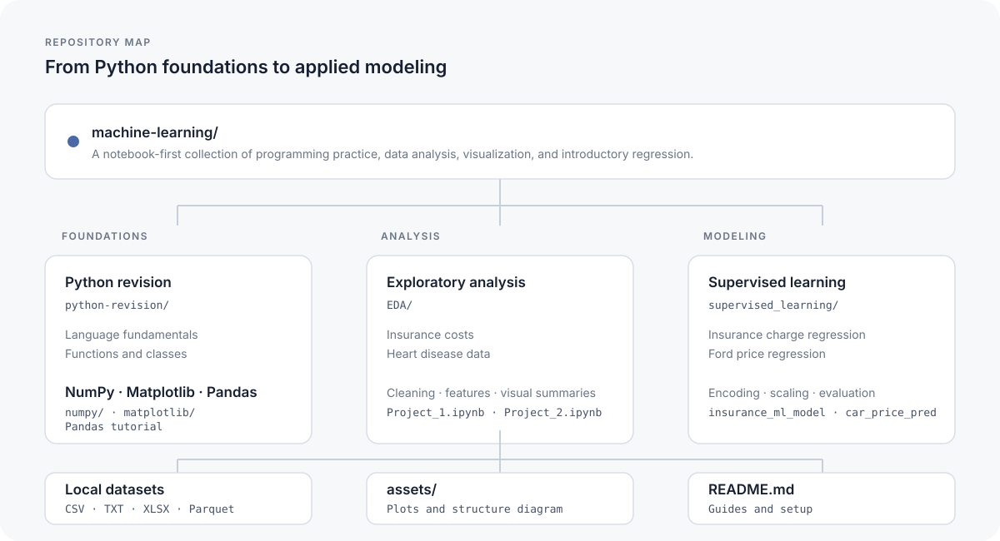

# Machine Learning

A practical learning repository for Python, data analysis, visualization, and introductory machine learning. It combines guided notebook exercises with exploratory analyses and regression workflows built around local datasets.

<p align="center">
  
</p>

## Contents

- [Repository overview](#repository-overview)
- [Learning paths](#learning-paths)
- [Featured analyses](#featured-analyses)
- [Setup](#setup)
- [Running the notebooks](#running-the-notebooks)
- [Technology](#technology)
- [Data and interpretation](#data-and-interpretation)

## Repository overview

| Directory | Purpose | Entry point |
| --- | --- | --- |
| `python-revision/` | Short Python examples covering variables, types, functions, methods, classes, and special methods | Individual `.py` files |
| `numpy/` | Array creation, indexing, operations, statistics, reshaping, and file loading | [`numpy_tut.ipynb`](numpy/numpy_tut.ipynb) |
| `matplotlib/` | Plotting exercises for lines, bars, pies, scatter plots, histograms, and subplot layouts | [`Untitled0.ipynb`](matplotlib/Untitled0.ipynb)–[`Untitled7.ipynb`](matplotlib/Untitled7.ipynb) |
| `complete-pandas-tutorial-master/` | A comprehensive Pandas tutorial, datasets, reference sheet, and dependency list | [`tutorial.ipynb`](complete-pandas-tutorial-master/tutorial.ipynb) · [folder guide](complete-pandas-tutorial-master/README.md) |
| `EDA/` | Exploratory analysis and preparation of insurance and heart disease datasets | [folder guide](EDA/README.md) · [`Project_1.ipynb`](EDA/Project_1.ipynb) · [`Project_2.ipynb`](EDA/Project_2.ipynb) |
| `supervised_learning/` | Linear regression notebooks for insurance charges and Ford car prices | [folder guide](supervised_learning/README.md) · [`insurance_ml_model.ipynb`](supervised_learning/insurance_ml_model.ipynb) · [`car_price_pred.ipynb`](supervised_learning/car_price_pred.ipynb) |
| `assets/` | Plot images referenced by this documentation | PNG figures and the structure graphic |

The notebooks are self-contained learning exercises rather than a packaged Python application. No root-level dependency manifest or command-line entry point is present.

## Learning paths

### Foundations

Work through `python-revision/`, then `numpy/numpy_tut.ipynb`, the `matplotlib/` notebooks, and the [Pandas tutorial](complete-pandas-tutorial-master/README.md). These examples introduce core syntax, array operations, plotting, and tabular data manipulation.

### Applied analysis

The [`EDA/`](EDA/) notebooks explore insurance charges and heart disease records. They cover descriptive analysis, data quality checks, visualization, encoding, imputation, and scaling.

### Introductory modeling

The [`supervised_learning/`](supervised_learning/) notebooks use linear regression for medical insurance charges and Ford vehicle prices. They compare feature preparation approaches and evaluate a held-out split.

## Featured analyses

### Insurance costs

[`EDA/Project_1.ipynb`](EDA/Project_1.ipynb) examines the `insurance.csv` dataset (1,338 rows, seven columns), removes a duplicate, explores distributions and associations, and prepares encoded and scaled features. The related [`insurance_ml_model.ipynb`](supervised_learning/insurance_ml_model.ipynb) fits a linear regression model to insurance charges using an 80/20 train/test split.

### Heart disease

[`EDA/Project_2.ipynb`](EDA/Project_2.ipynb) explores 918 patient records and prepares categorical and numeric features for classification. It treats zero readings for cholesterol and resting blood pressure as missing values. Review the notebook cell that performs the resting blood pressure replacement before relying on its output: the current expression uses the cholesterol mean variable.

### Ford vehicle prices

[`car_price_pred.ipynb`](supervised_learning/car_price_pred.ipynb) analyzes `ford.csv`, encodes categorical features, scales numeric features, and fits linear regression. The notebook includes one-hot and label-encoded feature paths; inspect the model evaluation cells when reproducing results, as the label-encoded path currently predicts with the first model variable.

Plots from the exploratory notebooks are stored in [`assets/`](assets/). For example:

<p align="center">
  
  
</p>

## Setup

Use Python 3.9 or later and a virtual environment. Install the libraries used by the main analysis notebooks:

```bash
python3 -m venv .venv
source .venv/bin/activate
python -m pip install --upgrade pip
python -m pip install numpy pandas matplotlib seaborn scipy scikit-learn jupyter
```

On Windows PowerShell, activate the environment with `.venv\Scripts\Activate.ps1`. The Pandas tutorial has its own [`requirements.txt`](complete-pandas-tutorial-master/requirements.txt); install those dependencies from that folder as described in its [README](complete-pandas-tutorial-master/README.md).

The heart disease EDA notebook also imports `sheryanalysis` to create an automated report. That package is not listed in a repository dependency manifest. Install it separately only if you intend to run that report cell; the other analysis cells do not depend on it.

## Running the notebooks

Start Jupyter from the relevant project directory so notebook-relative CSV paths resolve:

```bash
cd EDA
jupyter notebook
```

Open `Project_1.ipynb` or `Project_2.ipynb` and run cells in order. For the modeling notebooks:

```bash
cd ../supervised_learning
jupyter notebook
```

For NumPy's text-file exercise, launch Jupyter from `numpy/` so `data.txt` can be found. Most Matplotlib exercises are standalone; `Untitled7.ipynb` reads `/content/data.csv` and therefore needs its dataset path updated for a local run. The older `complete-pandas-tutorial-master/tut.ipynb` also contains absolute paths from its original machine; use `tutorial.ipynb`, which uses paths relative to its folder.

Select a Python kernel with the installed dependencies. To preserve generated notebook outputs, save the notebook after execution.

## Technology

| Area | Tools present in the notebooks |
| --- | --- |
| Language and notebooks | Python, Jupyter |
| Arrays and data tables | NumPy, Pandas |
| Visualization | Matplotlib, Seaborn |
| Statistics and modeling | SciPy, scikit-learn |
| Pandas tutorial extras | `openpyxl`, `pyarrow`, `pyjanitor`, `ipykernel` |

## Data and interpretation

Datasets are stored alongside the notebooks that use them. The analyses demonstrate techniques on fixed sample data; their correlations and model scores describe those datasets and should not be treated as causal, clinical, or production-ready conclusions. Check each notebook's preprocessing and evaluation cells before reusing results.
