# Machine Learning

A structured collection of Python, data analysis, and visualization work that builds the groundwork for machine learning. The repository combines two end-to-end exploratory data analysis (EDA) and feature engineering projects, one on medical insurance costs and one on heart disease, with focused practice modules covering Python fundamentals, NumPy, Matplotlib, and Pandas.

---

## Table of Contents

1. [Overview](#overview)
2. [Repository Structure](#repository-structure)
3. [Featured Projects](#featured-projects)
   - [Project 1: Insurance Cost Analysis](#project-1-insurance-cost-analysis)
   - [Project 2: Heart Disease Analysis](#project-2-heart-disease-analysis)
4. [Getting Started](#getting-started)
5. [Technology Stack](#technology-stack)
6. [Author](#author)

---

## Overview

This repository documents a progression from core programming concepts to applied data analysis. Its main objective is to prepare clean, well-understood data for predictive modeling.

| Area | Focus |
| --- | --- |
| Exploratory Data Analysis | Distribution analysis, outlier detection, correlation analysis |
| Data Preprocessing | Duplicate removal, missing value treatment, encoding, scaling |
| Feature Engineering | Binning, one-hot encoding, statistical feature selection |
| Foundations | Python, NumPy, Matplotlib, Pandas |

| Project | Dataset | Task | Target |
| --- | --- | --- | --- |
| Project 1 | Medical insurance (1,338 records) | Regression | `charges` |
| Project 2 | Heart disease (918 records) | Binary classification | `HeartDisease` |

---

## Repository Structure

```
machine-learning/
|-- EDA/
|   |-- Project_1.ipynb          # Insurance cost EDA and feature engineering
|   |-- insurance.csv            # Dataset (1,338 records, 7 attributes)
|   |-- Project_2.ipynb          # Heart disease EDA and preprocessing
|   `-- heart.csv                # Dataset (918 records, 12 attributes)
|-- numpy/
|   |-- numpy_tut.ipynb          # Array creation, math, linear algebra, statistics
|   `-- data.txt                 # Sample data for file-loading exercises
|-- matplotlib/
|   `-- Untitled0-7.ipynb        # Line, bar, pie, scatter, histogram, subplot practice
|-- python-revision/
|   |-- variables.py
|   |-- datatypes.py
|   |-- constants.py
|   |-- functions.py
|   |-- classAndInitialiser.py
|   |-- methods.py
|   `-- dunderMethods.py
|-- complete-pandas-tutorial-master/   # Pandas tutorial (third-party)
|-- assets/                      # Figures used in this README
`-- README.md
```

---

## Featured Projects

## Project 1: Insurance Cost Analysis

**Location:** `EDA/Project_1.ipynb`

The project analyzes how demographic and lifestyle attributes relate to individual medical insurance charges, and prepares the dataset for regression modeling.

### Dataset

| Attribute | Type | Description |
| --- | --- | --- |
| `age` | Integer | Age of the primary beneficiary |
| `sex` | Categorical | Gender of the beneficiary |
| `bmi` | Float | Body mass index |
| `children` | Integer | Number of dependents covered |
| `smoker` | Categorical | Smoking status |
| `region` | Categorical | Residential region in the United States |
| `charges` | Float | Individual medical costs billed by insurance (target variable) |

The dataset contains 1,338 records and 7 columns with no missing values. One duplicate record was identified and removed, leaving 1,337 records.

### Summary Statistics

| Statistic | Age | BMI | Children | Charges |
| --- | --- | --- | --- | --- |
| Mean | 39.21 | 30.66 | 1.09 | 13,270.42 |
| Std. deviation | 14.05 | 6.10 | 1.21 | 12,110.01 |
| Minimum | 18 | 15.96 | 0 | 1,121.87 |
| Median | 39 | 30.40 | 1 | 9,382.03 |
| Maximum | 64 | 53.13 | 5 | 63,770.43 |

### Methodology

1. **Exploratory analysis.** Shape, data types, null counts, descriptive statistics, histograms with density curves, count plots, box plots, and a correlation heatmap.
2. **Cleaning.** Removal of duplicate records and verification of missing values and data types.
3. **Encoding.** Binary mapping of `sex` and `smoker` (renamed to `is_female` and `is_smoker`) and one-hot encoding of `region`.
4. **Feature engineering.** BMI categorized into Underweight, Normal, Overweight, and Obese bands and one-hot encoded.
5. **Scaling.** Standardization of `age`, `bmi`, and `children` with `StandardScaler`.
6. **Feature selection.** Pearson correlation for numeric relationships with `charges`, and a chi-square test of independence (alpha = 0.05) between each categorical feature and quartile-binned charges.

### Results

#### Distribution of Charges

Medical charges are strongly right-skewed. Most beneficiaries incur lower costs, while a smaller secondary group sits in a much higher cost range.

<p align="center">
  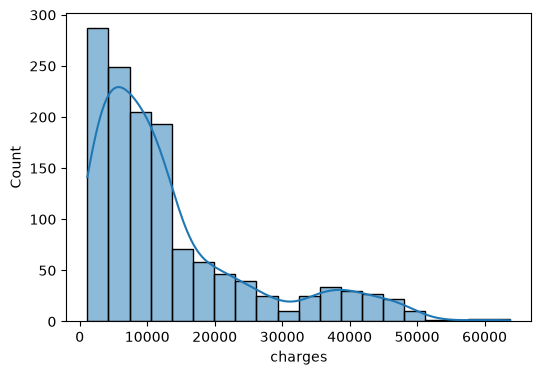
  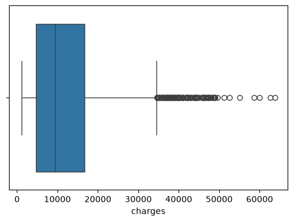
</p>

The box plot confirms a substantial number of high-value outliers above roughly 35,000, which is relevant when choosing a modeling approach and error metric.

#### Distribution of Predictors

<p align="center">
  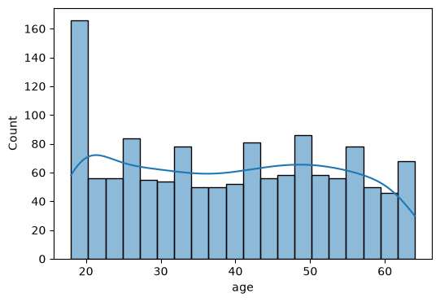
  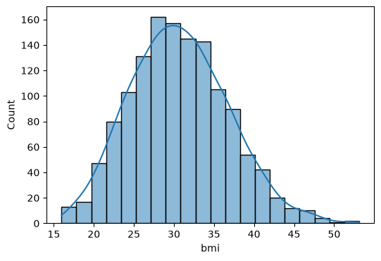
  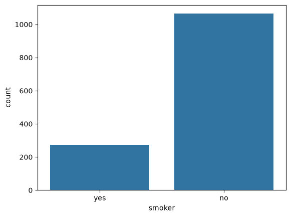
</p>

- Age is close to uniform across the 18 to 64 range, with a spike at the youngest age.
- BMI is approximately normally distributed, centered near 30.
- Non-smokers outnumber smokers: 1,063 versus 274 after duplicate removal.

#### Correlation Analysis

<p align="center">
  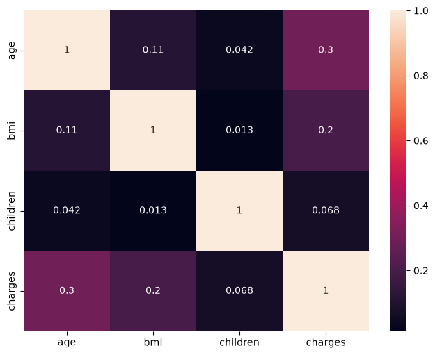
</p>

Among numeric variables, age (0.30) and BMI (0.20) show the strongest linear association with charges, while the number of children shows a weak association (0.07).

#### Feature Relevance

Pearson correlation with `charges` after encoding:

| Feature | Pearson Correlation |
| --- | --- |
| `is_smoker` | 0.787 |
| `age` | 0.298 |
| `bmi_category_Obese` | 0.200 |
| `bmi` | 0.196 |
| `region_southeast` | 0.074 |
| `children` | 0.067 |
| `is_female` | -0.058 |

Chi-square test results (alpha = 0.05):

| Feature | Chi-square | p-value | Decision |
| --- | --- | --- | --- |
| `is_smoker` | 848.22 | < 0.001 | Keep |
| `region_southeast` | 16.00 | 0.0011 | Keep |
| `is_female` | 10.26 | 0.0165 | Keep |
| `bmi_category_Obese` | 8.52 | 0.0365 | Keep |
| `region_southwest` | 5.09 | 0.1652 | Drop |
| `bmi_category_Overweight` | 4.25 | 0.2356 | Drop |
| `bmi_category_Normal` | 3.71 | 0.2948 | Drop |
| `region_northwest` | 1.13 | 0.7688 | Drop |

### Key Findings

- Smoking status is by far the strongest predictor of insurance charges, with a correlation of roughly 0.79 and the largest chi-square statistic.
- Age and obesity are secondary drivers of cost.
- The final feature set retained for modeling is: `age`, `is_female`, `bmi`, `children`, `is_smoker`, `region_southeast`, and `bmi_category_Obese`, with `charges` as the target.

---

## Project 2: Heart Disease Analysis

**Location:** `EDA/Project_2.ipynb`

The project explores clinical and demographic attributes associated with the presence of heart disease, treats invalid zero-valued measurements, and prepares the dataset for binary classification.

### Dataset

| Attribute | Type | Description |
| --- | --- | --- |
| `Age` | Integer | Age of the patient in years |
| `Sex` | Categorical | Sex of the patient (M or F) |
| `ChestPainType` | Categorical | Chest pain category (ATA, NAP, ASY, TA) |
| `RestingBP` | Integer | Resting blood pressure |
| `Cholesterol` | Integer | Serum cholesterol |
| `FastingBS` | Binary | Fasting blood sugar indicator |
| `RestingECG` | Categorical | Resting electrocardiogram result |
| `MaxHR` | Integer | Maximum heart rate achieved |
| `ExerciseAngina` | Categorical | Exercise-induced angina (Y or N) |
| `Oldpeak` | Float | ST depression induced by exercise |
| `ST_Slope` | Categorical | Slope of the peak exercise ST segment |
| `HeartDisease` | Binary | Presence of heart disease (target variable) |

The dataset contains 918 records and 12 columns with no null values and no duplicate records. The target is moderately balanced, with 508 positive cases (55.3 percent) and 410 negative cases.

### Summary Statistics

Raw data, prior to missing value treatment:

| Statistic | Age | RestingBP | Cholesterol | MaxHR | Oldpeak |
| --- | --- | --- | --- | --- | --- |
| Mean | 53.51 | 132.40 | 198.80 | 136.81 | 0.89 |
| Std. deviation | 9.43 | 18.51 | 109.38 | 25.46 | 1.07 |
| Minimum | 28 | 0 | 0 | 60 | -2.60 |
| Median | 54 | 130 | 223 | 138 | 0.60 |
| Maximum | 77 | 200 | 603 | 202 | 6.20 |

The minimum values of 0 for `RestingBP` and `Cholesterol` are physiologically implausible and indicate missing measurements recorded as zero.

### Methodology

1. **Exploratory analysis.** Shape, data types, null and duplicate checks, descriptive statistics, target balance, histograms with density curves, grouped count plots by outcome, box and violin plots, and a correlation heatmap. An automated summary report is also generated with the `sheryanalysis` helper package.
2. **Cleaning.** Zero-valued `Cholesterol` and `RestingBP` records are treated as invalid and imputed with a mean value, and the distributions are re-plotted to verify the result.
3. **Encoding.** One-hot encoding of all categorical variables with the first level dropped to avoid redundancy.
4. **Scaling.** Standardization of `Age`, `RestingBP`, `Cholesterol`, `MaxHR`, and `Oldpeak` with `StandardScaler`.

### Results

#### Target Balance

<p align="center">
  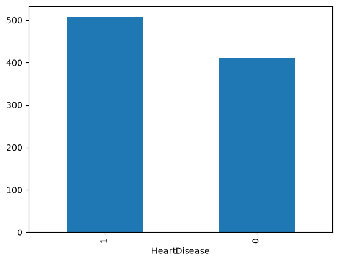
</p>

#### Effect of Missing Value Treatment

The raw `Cholesterol` distribution shows a pronounced spike at zero, corresponding to 172 records with missing measurements. After imputation, the distribution is unimodal and no longer contains the artificial zero cluster.

<p align="center">
  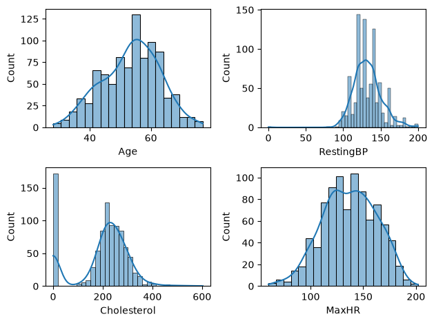
  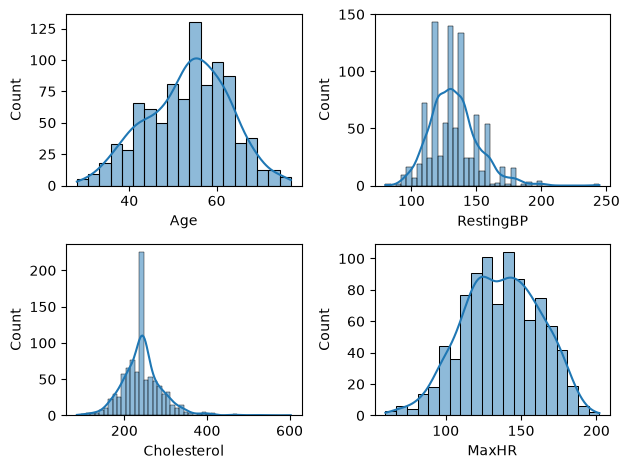
</p>

<p align="center">
  <em>Left: raw distributions. Right: distributions after imputation.</em>
</p>

#### Categorical Features by Outcome

<p align="center">
  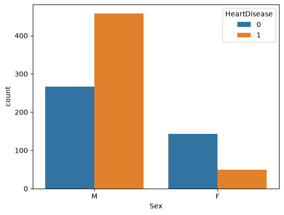
  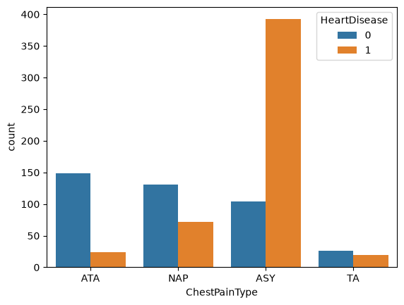
  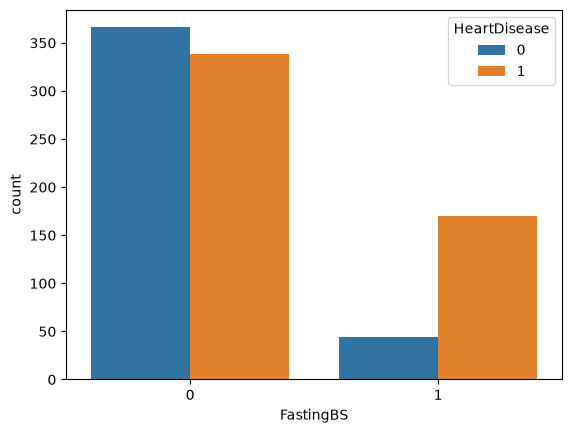
</p>

- Heart disease is more prevalent among male patients than female patients in this dataset.
- Asymptomatic chest pain (ASY) is by a wide margin the category most associated with a positive diagnosis, while ATA and NAP are predominantly negative.
- Patients with the fasting blood sugar indicator set to 1 are positive in roughly four of every five cases.

#### Numerical Features by Outcome

<p align="center">
  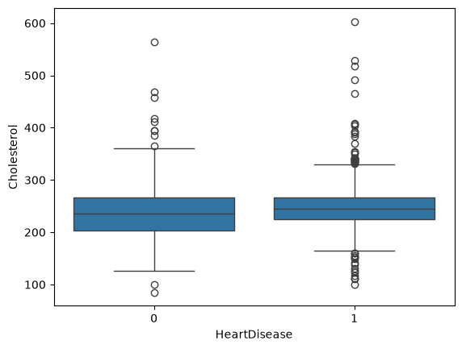
  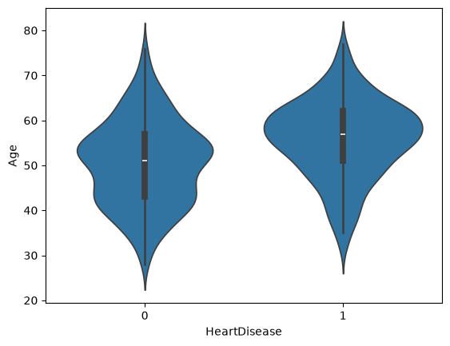
</p>

- Cholesterol shows little separation between outcomes, and both groups contain high-value outliers.
- Patients with heart disease skew older, with a median age several years above that of patients without it.

#### Correlation Analysis

<p align="center">
  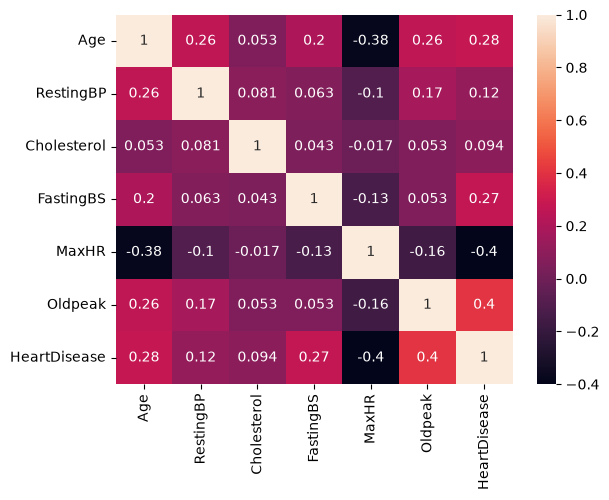
</p>

Correlation with `HeartDisease`:

| Feature | Correlation |
| --- | --- |
| `Oldpeak` | 0.40 |
| `MaxHR` | -0.40 |
| `Age` | 0.28 |
| `FastingBS` | 0.27 |
| `RestingBP` | 0.12 |
| `Cholesterol` | 0.09 |

### Key Findings

- `Oldpeak` and `MaxHR` show the strongest linear relationships with the target, in opposite directions: higher ST depression and lower peak heart rate are both associated with disease.
- Chest pain type, sex, fasting blood sugar, and age provide additional clear separation between outcomes.
- Cholesterol and resting blood pressure are comparatively weak individual indicators.
- Roughly 19 percent of cholesterol readings were missing and recorded as zero, which makes missing value treatment a necessary step before modeling.
- The encoded and scaled dataset is ready for classification modeling.

These results describe statistical associations within a single dataset and are not clinical conclusions.

---

## Getting Started

### Prerequisites

- Python 3.9 or later
- pip
- The `sheryanalysis` helper package, required by `EDA/Project_2.ipynb` for its automated summary report

---

## Technology Stack

| Category | Tools |
| --- | --- |
| Language | Python |
| Data manipulation | NumPy, Pandas |
| Visualization | Matplotlib, Seaborn |
| Statistics and preprocessing | SciPy, scikit-learn |
| Environment | Jupyter Notebook |

---

## Author

**Aditya Saraswat**
